# agent-mqi

**Model Quality Index (MQI): a 24-metric score that flags when an AI coding agent's sessions are getting worse, built from 2,740 of my own Claude Code sessions over 13 weeks.**

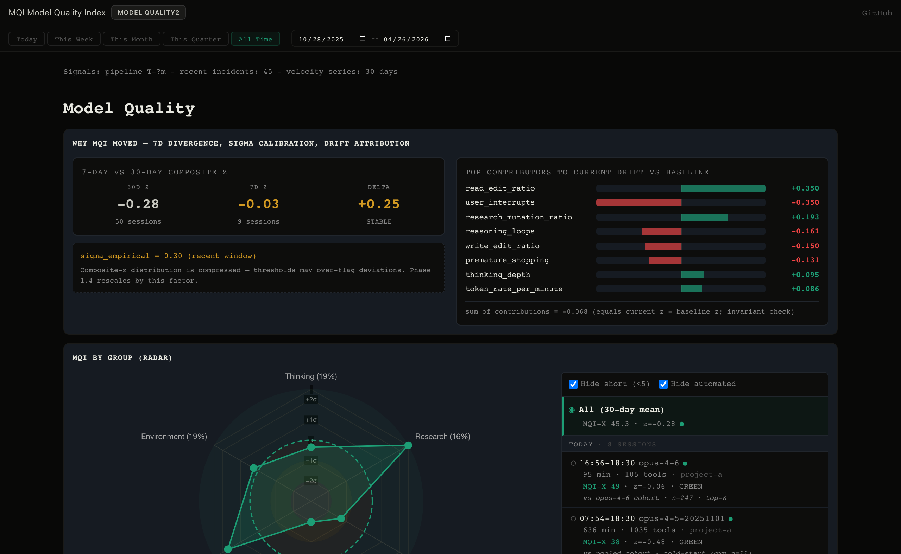

I run AI coding agents for most of my day. Some days they seemed sharp and some days they seemed off, and I had no way to tell a worse model from a harder task or a bad day of my own. MQI reads Claude Code session transcripts, measures 24 behaviours in each session (how much the agent read before editing, how often I had to interrupt or repeat an instruction, how much it reasoned, how often it retried after an error), and scores every session against that model's own best sessions.

It is a Rust CLI and a static dashboard. It runs locally on your own transcripts and sends nothing anywhere except two public status feeds (service incidents and issue velocity).

---

## What I used it for

Each model is scored against its own baseline, so a drop means "worse than this model's own best work", not "worse than another model". In weeks 12 to 13, Opus sessions fell below their own baseline, and I moved part of my work from Opus to a mix of Opus and Sonnet. That was a routing decision made from the score. I did not run a controlled comparison afterwards, so I can't say how much the switch helped.

Per model, from the dashboard snapshot in `dashboard/data/mqi.example.json` (all 6,223 sessions, automated ones included; 50 is baseline quality):

| Model | Sessions | Avg MQI-X |
|---|---|---|
| Sonnet 4.6 | 2,653 | 50.3 |
| Opus 4.6 | 247 | 45.6 |
| Opus 4.7 | 71 | 43.4 |
| Opus 4.5 | 11 | 45.4 |
| Haiku 4.5 | 4 | 51.5 |
| Synthetic or unlabelled | 3,237 | 50.6 to 51.3 |

The hardest tasks went to Opus, so these gaps mix model and task difficulty. They are a reason to look inside each model's own trend, not a ranking of models.

## A correction to my own headline

The first version of this README said my frustration fell as my tooling improved, citing the weekly sentiment chart. When I looked again, that rise came from the last two weeks, where 2,294 of 2,434 sessions sit at exactly 5.0. That is the midpoint of the scale, and it looks like a default for sessions with no keyword signal, mostly automated runs. With those 2,364 midpoint sessions left out, the trend goes the other way: weeks 15 and 16 average 1.4 against 2.2 before. I also wrote that the score proved things it does not prove. The chart below is redrawn with the midpoint sessions left out of the line.

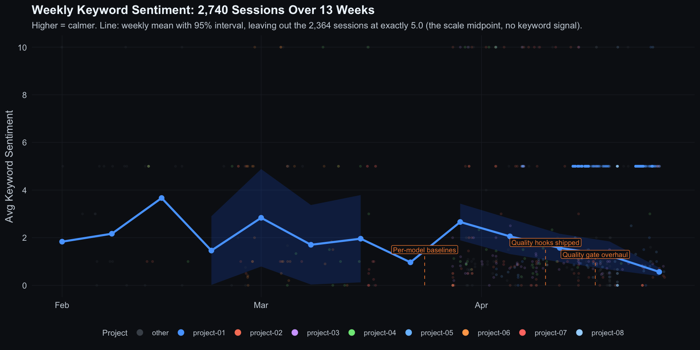

> Reproducible: `Rscript scripts/sentiment-trend.R scripts/sentiment-data.csv docs/screenshots/sentiment-trend.png`. Project names and session ids in the CSV are replaced with generic labels.

What the sentiment data does support: keyword sentiment is noisy, its value depends on which sessions you count, and it belongs at the lowest weight (0.02), which is where MQI puts it.

## Per-model baselines

New model versions can trade explicit reasoning for implicit. When Opus 4.7 arrived, its thinking blocks were shorter, and against a pooled baseline built mostly from earlier models every 4.7 session looked degraded. So each model is compared against its own top sessions: Opus 4.7 against Opus 4.7, not against Sonnet.

## Quick start

```bash
git clone https://github.com/Alex-Zeo/agent-mqi.git
cd agent-mqi
cargo build --release
./target/release/mqi -o dashboard/data/mqi.json
cd dashboard && python3 -m http.server 8080
# open http://localhost:8080
```

`mqi` scans `~/.claude/projects/` for session transcripts, computes per-model baselines and scores each session. Your output (`dashboard/data/mqi.json`) is git-ignored because it holds your own session details. Without it the dashboard loads the example data.

## The 24 metrics

| Group | Metrics | Weight |
|-------|---------|--------|
| **Thinking** | thinking_depth, reasoning_loops, zero_reasoning_turn_rate, redaction_rate | 19% |
| **Research** | read_edit_ratio, research_mutation_ratio, simplest_fix | 16% |
| **Execution** | edits_without_read, write_edit_ratio, premature_stopping, repeated_edits, stop_hook_violations, reversion_rate, post_compaction_drift, human_time_estimation, trial_and_error_debugging | 23% |
| **Trust** | user_interrupts, self_admitted_failures, keyword_sentiment, re_instruction_rate, implicit_constraint_violator | 18% |
| **Throughput** | token_rate_per_minute | 5% |
| **Environment** | incident_exposure, issue_velocity | 19% |

- **thinking_depth**: average length of thinking per turn.
- **read_edit_ratio**: reads before edits; research before changing code.
- **user_interrupts**: times I stopped the agent mid-task.
- **keyword_sentiment**: share of positive words (done, fixed, complete, success, works) against negative ones (error, fail, bug, broken, issue). A supporting signal only.
- **incident_exposure**: share of the session that overlapped a published service incident.

The weights are my own judgment, set by hand. They are not fitted to an outcome, and the metrics have not been validated against an independent measure of session quality. That is the next step I would take.

## How it works

```
~/.claude/projects/          your Claude Code session transcripts
        |
        v
    mqi CLI                  parses sessions, extracts 24 metrics
        |
        v
  mqi.json                   scored sessions with z-scores and status
        |
        v
  dashboard                  trends, per-model view, drift attribution
```

## Scoring

1. **Transform** each metric toward normality (logit for ratios, log1p for counts).
2. **Baseline**: each model's top-K sessions form that model's baseline.
3. **Z-score** against the baseline with robust estimators.
4. **Orient** so a positive z always means better.
5. **Weight** and sum across the 24 metrics.
6. **Scale** to 0 to 100 with a sigmoid. 50 is baseline quality.

## Dashboard

### WHY MQI MOVED

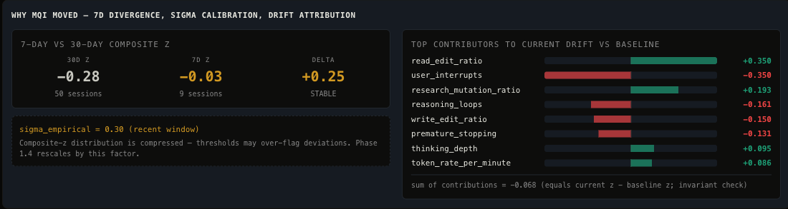

Compares your last 7 days against your last 30 days and tells you which metrics are driving the change. The bars on the right show which metrics moved the composite most. A gap between the 7-day and 30-day values says something changed; it does not say whether the cause was the model, the task mix or the workflow.

### MQI BY GROUP (RADAR)

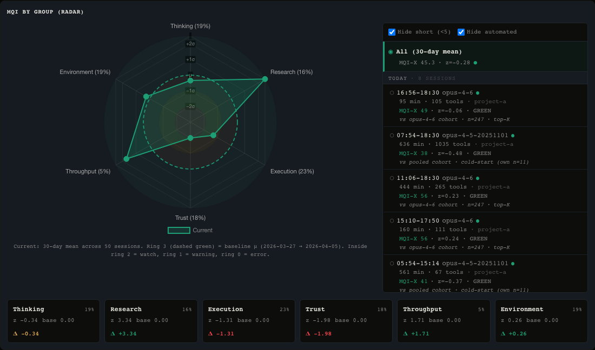

Hexagonal radar chart plotting z-scores across all six behavioral dimensions (Thinking, Research, Execution, Trust, Throughput, Environment). A balanced hexagon means consistent quality. A collapsed vertex means one dimension is degrading. The session picker on the right lets you drill into any individual session to see its radar shape.

### GROUP LEGEND

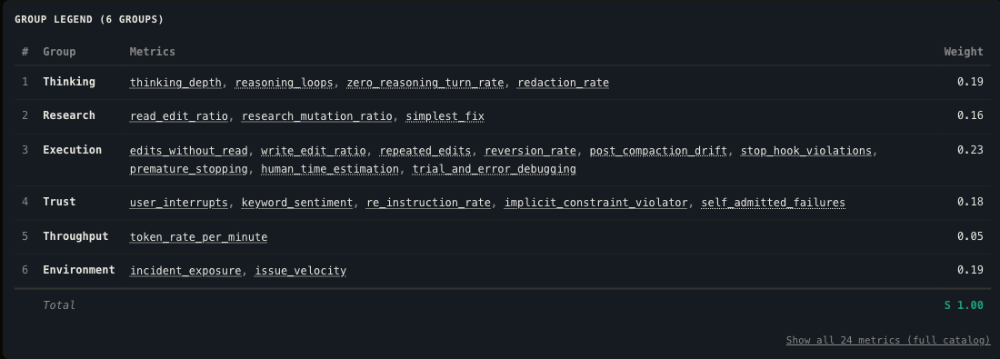

Full breakdown of all 24 metrics organized by group, with weights and status indicators. This is your reference card. Each metric shows its current z-score and whether it's firing above or below baseline. Use this to understand what MQI is actually measuring when a score changes.

### EXTERNAL SIGNALS

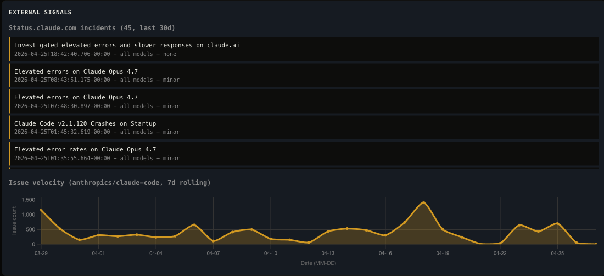

Pulls live incident data from status.claude.com and correlates it with your sessions. The incident feed on the left shows service disruptions. The issue velocity chart on the right shows spikes. This is why `incident_exposure` is a metric: a session that ran during a service incident should not count against the model or the user.

### MQI TREND

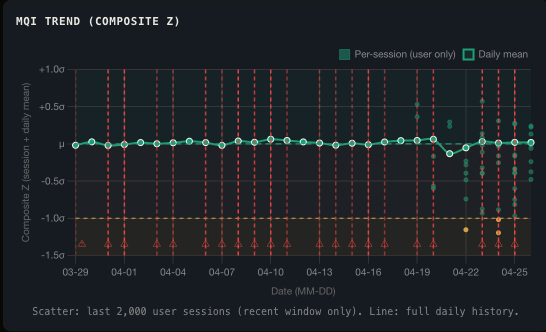

Composite z-score time series with per-session scatter. The trend line shows your rolling quality trajectory. Individual dots are sessions. Drops below the line are degradation events. Use it to spot multi-day slides.

### CLAUDE CODE VERSION

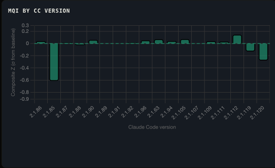

MQI scores bucketed by Claude Code CLI version. When Anthropic ships a new CLI version, your session quality may shift. This chart catches regressions (or improvements) that correlate with tooling updates rather than model changes.

### MQI BY MODEL

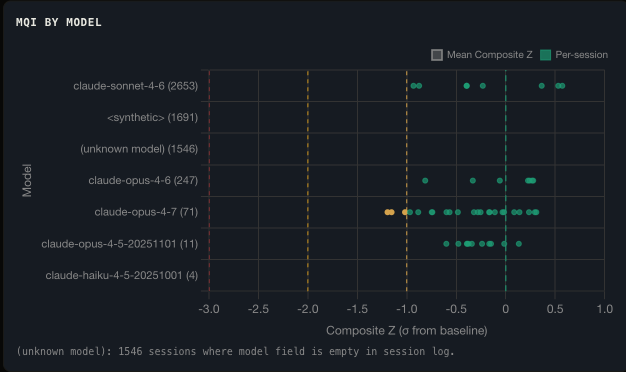

Per-model composite z-score dot plot. Each dot is a session. This is how you compare Opus vs Sonnet vs Haiku at a glance. In my data the hardest tasks went to Opus, so cross-model gaps mix model and task difficulty. Compare within a model, not across models.

### KEYWORD SENTIMENT

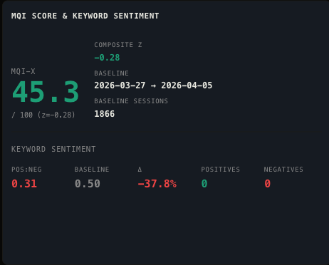

Your MQI score alongside your keyword sentiment ratio. The number on the left is your composite score. The ratio shows positive-to-negative keyword balance. Keyword sentiment is a weak signal (weight 0.02); read it next to the composite, never alone.

### MODEL DEGRADATION

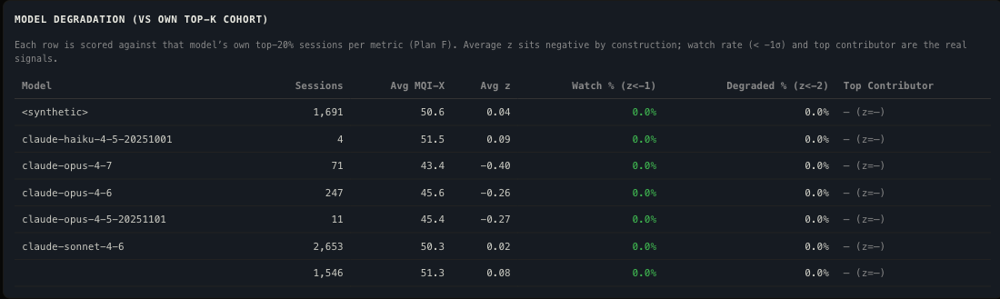

Top-K cohort comparison table per model. Shows each model's best sessions (the baseline cohort) versus recent sessions. When the delta is negative, that model is performing worse than its own historical best. A sustained negative delta is the signal I used to move work to another model.

### THINKING DEPTH BY HOUR / DAY

| | |
|---|---|
| 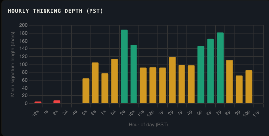 | 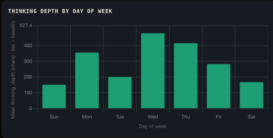 |

Thinking depth broken out by hour of day (PST) and day of week. Thinking depth here is measured from thinking-block signature length, a proxy. The hour and weekday patterns are descriptive; they also reflect which tasks I ran at which times.

## Library use

```rust
use agent_mqi::{SessionMetrics, score_session, compute_baseline};

struct MySession { /* ... */ }

impl SessionMetrics for MySession {
    fn metric_value(&self, index: usize) -> f64 {
        0.0
    }
}

let baseline = compute_baseline(&sessions, &dates, "2025-01-01", "2025-01-31");
let score = score_session(&current_session, &baseline);
println!("MQI-X: {:.1}/100", score.mqi_x);
```

```toml
[dependencies]
agent-mqi = { git = "https://github.com/Alex-Zeo/agent-mqi" }
```

## Example data and privacy

`dashboard/data/mqi.example.json` and `scripts/sentiment-data.csv` come from my own sessions, with project names and session ids replaced by generic labels. They hold scores, timings and model names, and no transcript text.

## Limits

- One user's sessions. Nothing here generalises beyond my own work.
- The weights are hand-set and the composite is not validated against an independent quality label.
- Task difficulty is not controlled, so model comparisons mix model and task.
- Thinking depth is a proxy taken from signature length.

## Related

The same question, how to keep oversight of long AI agent work when no one is watching, drives my current project: [Alex-Zeo/agent-fleet-oversight](https://github.com/Alex-Zeo/agent-fleet-oversight).

## License

MIT
